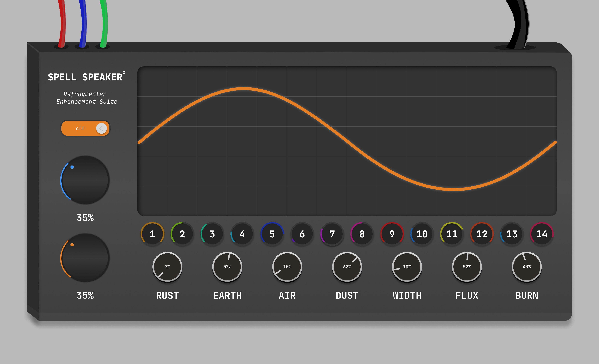

# spellspeaker
Wavetable too

**Spell Speaker² — Defragmenter Enhancement Suite** is an imaginary hardware synth box that actually works. Each knob reshapes the waveform on the scope, and when you flip the switch on it plays what you see.

The panel started as a Figma mockup. This repo is that mockup rebuilt as a single self-contained web page: plain HTML, SVG, Canvas and the Web Audio API, with no build step and no dependencies.

## Run it

Open `index.html` in a modern browser. That's it. Sound starts when you flip the power switch, since browsers only allow audio after a click.

To serve it locally instead: `python3 -m http.server` and visit `http://localhost:8000`.

## Controls

| Control | What it does |
| --- | --- |
| **Power switch** | Starts the scope moving, the cables swaying and the sound playing. Dark when off, orange when on |
| **Dice button** (or press **R**) | Rolls random settings: every knob sweeps to a new value and a few slots get cast |
| **Blue knob** (amplitude) | Height of the wave and how loud it is |
| **Orange knob** (frequency) | Cycles on screen and the pitch. 35% = one cycle at A2 (110 Hz) |
| **Slots 1–14** | Click to add a harmonic (slot *n* adds harmonic ×*n*+1). Drag a slot to set its strength |
| **RUST** | Grit and static |
| **EARTH** | Sub-octave weight. Off at 50%, flipped either side of it |
| **AIR** | A high, shimmering overtone |
| **DUST** | Phosphor trails on the scope and a muffled sound |
| **WIDTH** | Stereo detune, drawn as a ghost trace |
| **FLUX** | Drift and vibrato. Still at 50%, drifts left or right from there |
| **BURN** | Saturation that squares the wave off |
| **Tuner** | Bottom-left of the scope: note, cents meter and exact pitch. Green within ±5¢ |

**Interaction:** drag or scroll any knob, hold Shift for fine control, double-click to reset. Every control also works from the keyboard: Tab to focus, arrow keys to adjust, Home and End for the extremes, Enter or Space to toggle a slot.

## How it works

- **Scope:** a Canvas redraws the signal every frame. DUST sets how quickly old frames fade, which is where the trails come from.
- **Audio:** an AudioWorklet runs the same signal function on the browser's audio thread, so drawing never interrupts the sound. Parameter changes glide sample by sample to avoid zipper noise. Browsers without AudioWorklet fall back to a ScriptProcessor with a large buffer.
- **Panel:** inline SVG, laid out at the Figma frame's proportions and scaled to fit the window.

## Credits

Design by Dylan Straffon. Built with Claude.
